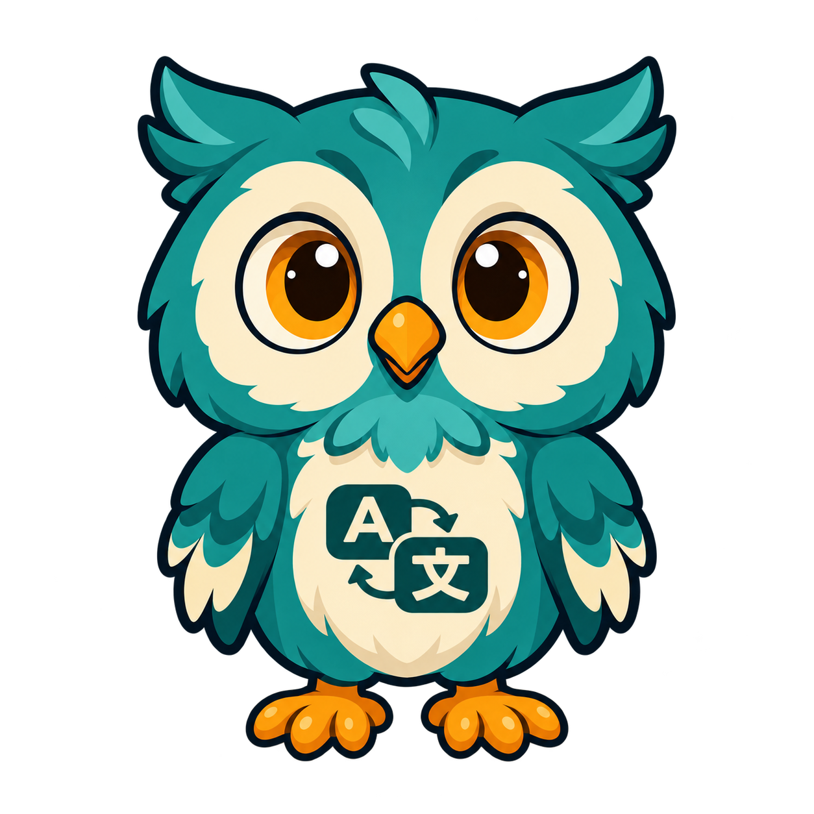
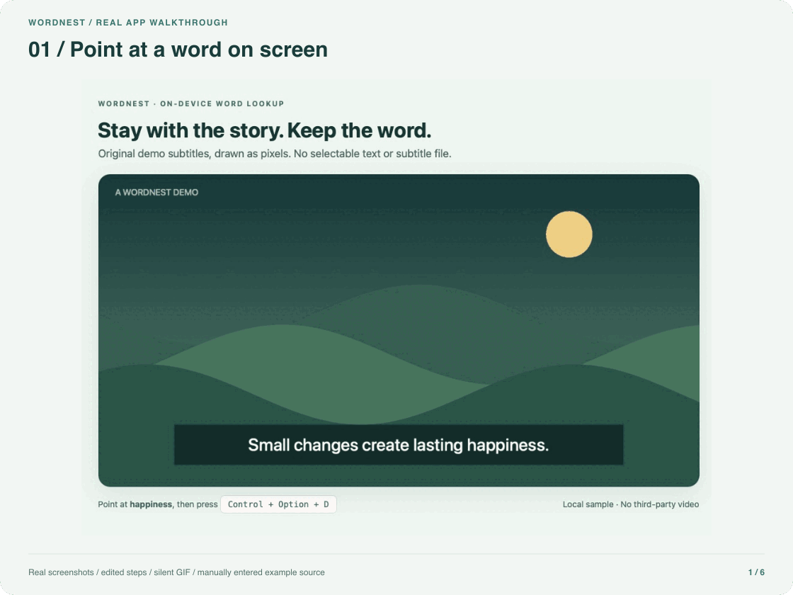
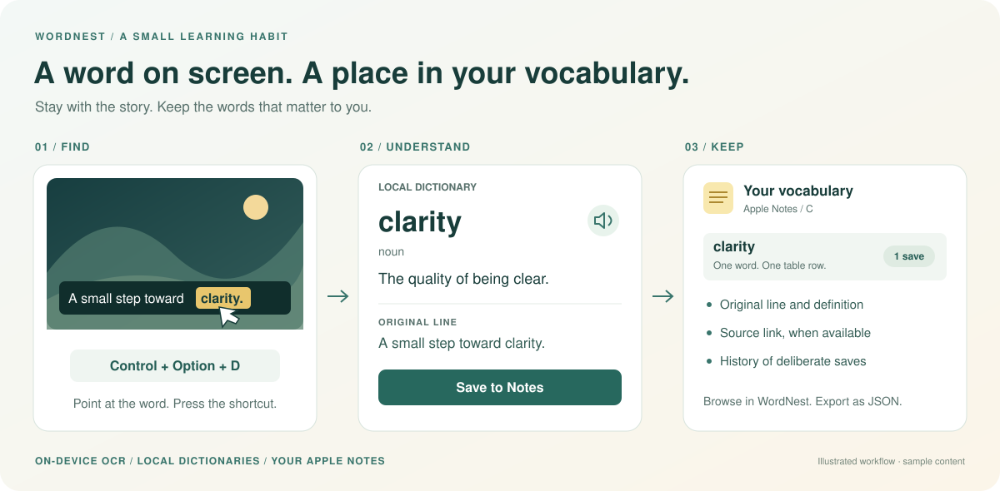
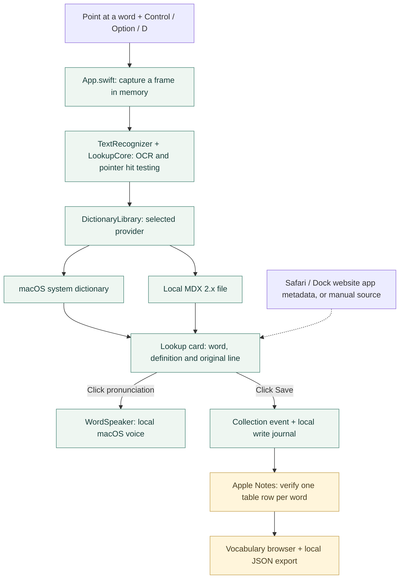

<p align="center">
  
</p>

# WordNest

**Look up words where you find them. Keep them in Apple Notes.**

English · [简体中文](README.zh-CN.md)

[](https://github.com/Albort12138/WordNest/actions/workflows/ci.yml)

**Native Swift + AppKit · Apple Silicon · macOS 14+ · Code: MIT / artwork: separate license**

[Download for Apple Silicon](https://github.com/Albort12138/WordNest/releases/download/v26.1.0/WordNest-26.1.0-build1-macos-arm64-unnotarized.dmg) · [Try from source](#build-from-source) · [How it works](#how-it-works) · [Explore the code](#repository-map) · [Contribute](CONTRIBUTING.md)

WordNest is a free, open-source macOS menu bar app for learning from subtitled videos and on-screen text. Point at a word, press **Control + Option + D**, look up its meaning, hear its pronunciation, and save it with the original line and an available source link.

OCR, dictionary lookup, and speech synthesis run on your Mac. WordNest has no account, backend, cloud translation, or analytics. Your vocabulary lives in Apple Notes.

> **Public test release:** [**26.1.0 (build 1)**](https://github.com/Albort12138/WordNest/releases/tag/v26.1.0) is available for small-group testing. The installer is **unnotarized and ad-hoc signed**; macOS may block first launch. See the [installation guide](docs/INSTALL.md). No Apple developer membership is required to build from source.

## See it in the real app



*28-second, silent walkthrough assembled from real app screenshots; edited steps, not a continuous screen recording. The subtitle sample is self-authored, the example source is entered manually, and saving uses an isolated `WordNest Demo` folder. [Capture notes](Assets/Documentation/README.md).*

<details>
<summary>View the three-step workflow illustration</summary>




*Workflow illustration with sample content, not an application screenshot. Source metadata is saved when available; dictionary content depends on your chosen dictionary.*

</details>

| Point and look up | Hear and understand | Keep the context |
| --- | --- | --- |
| **Control + Option + D** over visible text, even when subtitles cannot be selected. | In-card definitions from system dictionaries or your own MDX files; click to pronounce. | One Notes row per word, with original lines, available source links and deliberate collection history. |

## When WordNest helps

- **Watching subtitled videos:** Look up unfamiliar words without selectable subtitles or a subtitle file.
- **Reading text you cannot select:** Capture a word from an image or another app's visible text.
- **Keeping the context:** Save the original line and, when available, the page title and URL alongside the word.
- **Building your own notebook:** Browse saved words in WordNest or Apple Notes, see how often you deliberately saved each word, and filter collections by source.

WordNest does not automatically pause videos. Changing subtitles, unclear text, or a pointer outside the word's bounds can cause a miss. You can correct the word in the lookup card.

## Install

### Download an app

Download [WordNest 26.1.0 Pre-release](https://github.com/Albort12138/WordNest/releases/tag/v26.1.0) from GitHub Releases, or get the [Apple Silicon DMG](https://github.com/Albort12138/WordNest/releases/download/v26.1.0/WordNest-26.1.0-build1-macos-arm64-unnotarized.dmg) directly. Packages ending in `-unnotarized` are ad-hoc signed, **not Developer ID-signed or notarized by Apple**; macOS may block first launch.

1. Download the Apple Silicon `-unnotarized.dmg` and its SHA-256 checksums attached to a published release. Verify the matching checksum.
2. Open the disk image and drag **WordNest.app** into **Applications**.
3. Open WordNest from Applications and complete first-launch setup.

If macOS cannot verify the developer, review the [English installation guide](docs/INSTALL.md) or [中文安装说明](docs/INSTALL.zh-CN.md). It explains Apple's app-specific **Privacy & Security → Open Anyway** option when available. Do not disable Gatekeeper or remove quarantine attributes; malware/damage alerts require investigation. Checksum verification is not Apple review or verified developer identity.

### Build from source

Requires an Apple Silicon Mac, macOS 14 or later, and Apple Command Line Tools or Xcode. There are no third-party package dependencies.

```sh
git clone https://github.com/Albort12138/wordnest.git
cd wordnest
bash scripts/build.sh
open work/build/WordNest.app
```

The default build is ad-hoc signed for local development, using a separate development bundle identity. Rebuilding can invalidate previous macOS permissions. Preserve a working authorized build while testing a replacement. The public unnotarized package also uses an ad-hoc signature, so updates can require renewed privacy permissions. Developer ID signing and notarization remain an optional future distribution route; they are not required for source builds or explicitly unnotarized downloads.

## First launch

The setup window explains and guides permissions for your selected workflow. macOS requires you to approve each system permission yourself; copying an app into Applications cannot grant them automatically.

Setup opens with a dedicated **Choose your language** page. **System default** is selected automatically, with the resolved language shown beside it; **简体中文** and **English** are also visible without opening a menu. Changing the selection updates the page immediately. Continue to permission setup when ready. Interface language is independent of OCR language. System default follows supported macOS language preferences and falls back to English when none match. Your explicit choice is retained across permission-related restarts.

Reopen **Settings…** from the menu bar whenever you want to resume setup, change interface language, review permissions, or change the notebook location. Separate permission commands are consolidated into this settings flow. Before a permission action or restart, WordNest saves the current setup step. If macOS's Quit & Reopen action closes the app without relaunching it, reopen the same copy yourself to resume; WordNest does not assume the system always launches it again.

| Permission | Why it is used |
| --- | --- |
| Screen Recording | Capture a single frame when you invoke lookup, then recognize the area near the pointer locally. Required for screen lookup. |
| Automation → Notes | Read and write WordNest vocabulary pages in your selected Apple Notes location. |
| Automation → Safari | Read the current page title and URL for a regular Safari window. |
| Accessibility | Read page metadata from an active Safari website app added to the Dock. OCR itself does not need it. |

You can use lookup without automatic source capture. If a source cannot be read, enter it manually before saving. Choose an ordinary Notes folder for saving; a Smart Folder can be used as a separate browsing view.

After setup:

1. Point at a word and press **Control + Option + D**.
2. Read the definition, click pronunciation if desired, and check the original line and source.
3. Click **Save to Notes** to save, or **Collect again** to record another collection of that word.

WordNest runs in the menu bar. Open **My vocabulary…** to browse or export. Pronunciation plays only when you click its button. These labels follow your interface-language choice.

## Choose a local dictionary

Open **Dictionaries…** from the menu bar or lookup card. The default is **macOS system dictionary**. Use **Import MDX…** to choose a local `.mdx` file, including a file you already use with Eudic, then select it in settings or the card's dictionary picker. Its text definitions appear directly inside WordNest. Installing the Eudic app alone does not expose its definitions to WordNest; you must supply an authorized dictionary file.

Imports are validated and copied into WordNest's local Application Support directory. Your original file stays unchanged. Selection survives restarting the app. Removing a dictionary deletes only WordNest's managed copy; saved vocabulary and the original file remain. Switching dictionaries repeats the lookup with the existing word, context and source URL; it does not collect the word. A missing entry or damaged file is reported for the selected dictionary, without a silent fallback.

<details>
<summary>Supported MDX formats and resource limits</summary>

Supported: **MDX 2.x**, UTF-8/UTF-16LE/GBK/GB2312/GB18030/Big5 text, zlib or uncompressed blocks, and standard encrypted key indexes (flag 2). MDX 1.x/3.x, LZO and password-protected files are not supported. Limits include 1 GiB per file, 1 million entries, 64 MiB of decoded key blocks, 32 MiB per decoded block and 4 MiB per entry. Import checks the container and key index; record blocks are decoded and verified when queried. Definitions are rendered as text, without scripts, remote resources, MDD images/audio or custom HTML layouts. Pronunciation still uses macOS voices. Import only files you have the right to use; dictionary licenses are separate from WordNest's MIT license.

</details>

## Your vocabulary, in Apple Notes

- Latin-script words are grouped into A–Z pages; other scripts use script-based categories. Each word occupies one row in a single table, including its collection history.
- Each deliberate collection records its time, original line, and available source title and URL inside that word’s collection-history cell. Older summary-only and two-table pages remain readable and migrate on the next deliberate collection without resetting counts or duplicating events.
- Saving a word from a later lookup increases its collection count. New original lines are appended without duplicating identical context. Repeated clicks, retries, and read-back checks of the same event do not add a collection.
- Browse by category, search words and definitions, filter by source, or export the read notebook snapshot as JSON for your own analysis.
- Statistics describe **words you saved** and **collection events**. They do not measure every unknown word in a video, viewing frequency, or how many times a word was spoken.

Save into an **ordinary folder**. Smart Folders are filtered views and cannot directly receive new notes; choose one separately for browsing if desired. Shared folders are unsupported. Changing the destination does not move existing vocabulary.

WordNest protects its managed tables: locked notes, duplicate pages, unexpected formats, and extra content can prevent updates. Keep additional images, checklists, and unrelated writing in separate notes. If a write cannot be confirmed, WordNest preserves the pending event instead of blindly adding it again.

## Local processing and privacy

WordNest itself makes no network requests. Capture, OCR, dictionary lookup, speech, and collection processing use local macOS APIs. Captured frames are held in memory, cropped for OCR, and are not saved or uploaded. No audio is captured.

**Apple Notes is the storage destination.** Choose **On My Mac** for local-only vocabulary storage. If you choose iCloud or another network-backed account, Apple Notes may synchronize independently of WordNest. Opening a saved website, downloading dictionaries or voices, and downloading the app involve services outside the local lookup pipeline.

Local settings and a minimal write journal prevent duplicate collections; the journal does not store word, definition, or sentence bodies. JSON export writes only to your chosen location and is not automatically sent to an AI service. See [PRIVACY.md](PRIVACY.md).

## Compatibility and limits

| Capability | Current scope |
| --- | --- |
| Hardware and OS | Apple Silicon, macOS 14+ build target. The downloaded installer and core workflow were tested on an existing M3 Mac with macOS 26.6.2; clean-machine installation and other configurations need validation. |
| App interface | System default, Simplified Chinese, or English. App menus, lookup cards, settings, and vocabulary browsing follow this choice; unknown system diagnostics may follow the OS language. |
| OCR | Automatic or explicit language selection, using languages available through the current macOS Vision installation. |
| Definitions | Enabled macOS Dictionary resources or a selected imported local MDX 2.x file. Definitions may be monolingual, unavailable, or unsuitable for a specific contextual meaning. Recognition does not guarantee a Chinese translation. |
| Pronunciation | Available macOS voices matching the detected or selected source language. Additional voice installation is managed by macOS. |
| Automatic source capture | Regular Safari windows and Safari website apps added to the Dock. Bilibili in a Dock website app has been tested locally; every site, full-screen configuration, and multi-display setup is not guaranteed. |
| Other browsers and players | Screen OCR may work; source URLs can be entered manually. Automatic URL support is not universal. |
| Notebook destinations | Apple Notes. Notion integration is not implemented. |

There is no phrase selection, contextual AI explanation, playback timestamp detection, or spaced-repetition scheduling. Words are not lemmatized (`run` and `running` stay separate); identically spelled words across languages currently share a row. Missing historical sources cannot be reconstructed automatically.

Interface translation does not translate dictionary entries, saved words, original lines, account/folder names, or existing Notes table schemas. Those retain their original content and stable storage format.

## How it works

The lookup pipeline stays on your Mac. Reading a page source and saving vocabulary are separate actions; a dictionary lookup alone never adds a collection.



Apple Notes may synchronize independently if you choose an iCloud-backed account. See [privacy](#local-processing-and-privacy) and the [architecture guide](docs/code-guide.md) for the boundaries.

## Repository map

No Swift experience yet? Start with the purpose of each folder, then follow one feature through its source files.

| Path | What belongs here |
| --- | --- |
| [`Sources/`](Sources/) | App logic and native windows |
| [`Assets/Localization/`](Assets/Localization/) | English and Chinese interface catalogs |
| [`Assets/Compatibility/`](Assets/Compatibility/) | Stable identifiers for existing Notes pages |
| [`Assets/Fixtures/`](Assets/Fixtures/) | Fixed sample text used by demos and checks |
| [`Assets/Branding/`](Assets/Branding/) | App artwork and its separate license |
| [`Assets/Documentation/`](Assets/Documentation/) | Editable SVG illustrations and real-app walkthrough |
| [`Tests/`](Tests/) | Model, parser, language and fixed-data checks |
| [`scripts/`](scripts/) | Build, test, source export and packaging commands |
| [`config/product.env`](config/product.env) | Single source of version, bundle ID and build target |
| [`config/source-files.txt`](config/source-files.txt) | Explicit allowlist for public source exports |
| [`.github/workflows/`](.github/workflows/) | CI and the manually triggered draft-release workflow |
| [`docs/`](docs/) | Architecture, permissions, validation and release notes |
| `work/` | Ignored local builds and private development material |

### Where to start changing things

| If you want to improve… | Start here |
| --- | --- |
| OCR and selecting the right word | [`LookupCore.swift`](Sources/LookupCore.swift) · [`TextRecognizer.swift`](Sources/TextRecognizer.swift) |
| Dictionary providers and imports | [`DictionaryProvider.swift`](Sources/DictionaryProvider.swift) · [`MDXReader.swift`](Sources/MDXReader.swift) |
| Definition cards and pronunciation | [`LookupCardBody.swift`](Sources/LookupCardBody.swift) · [`WordSpeaker.swift`](Sources/WordSpeaker.swift) |
| Page links and video-source grouping | [`SourceCapture.swift`](Sources/SourceCapture.swift) · [`CollectionSource.swift`](Sources/CollectionSource.swift) |
| Notes tables, history and collection counts | [`AlphabetBook.swift`](Sources/AlphabetBook.swift) · [`AlphabetNotes.swift`](Sources/AlphabetNotes.swift) |
| First-launch setup and interface languages | [`SetupWindow.swift`](Sources/SetupWindow.swift) · [`InterfaceLanguage.swift`](Sources/InterfaceLanguage.swift) |

[`App.swift`](Sources/App.swift) coordinates the shortcut and windows; `captureAtPointer` and `lookupAndShow` are useful landmarks. Start with [`LookupCore.swift`](Sources/LookupCore.swift) for small data types and geometry rules, then explore the [full module map and collection invariants](docs/code-guide.md).

### Useful contributions

Reproducible OCR edge cases, authorized MDX compatibility fixtures, safer Notes round trips, interface translations and macOS compatibility reports are useful starting points. Check [existing issues](https://github.com/Albort12138/WordNest/issues) and [contribution guidelines](CONTRIBUTING.md) before a larger change. Redact personal subtitles, URLs and notebook content from reports.

## Development

Product versions use `YY.feature.fix`; the first public test release is **26.1.0 (build 1)**. See the [release policy](docs/RELEASING.md#version-policy).

Swift and AppKit, with ScreenCaptureKit, Vision, Dictionary Services, AVFoundation, Natural Language, Apple Events, and system zlib. A small dictionary-provider interface isolates system lookup from local MDX storage and decoding. Application, test, script and configuration source uses English. Interface strings use English keys with bundled English/Chinese catalogs; multilingual examples and stable legacy Notes identifiers live in separate data resources.

```sh
# Core checks; optional checks require access to the corresponding system services.
bash scripts/test.sh --system-dictionary --speech

# Fixed-data AppKit checks: no screen capture or Notes writes.
work/build/WordNest.app/Contents/MacOS/SubtitleLookup --ui-self-test
```

Preview and release builds use bundle identifier `io.github.albort12138.wordnest`; default development builds use `io.github.albort12138.wordnest.development` to keep Launch Services and permission identities separate. Validated notebook and OCR-language preferences can be imported from the earlier prototype when no current choice exists; permissions and setup completion are not imported. The executable remains `SubtitleLookup`, and the shared local write journal retains its earlier support-directory name to preserve duplicate prevention. Build products belong in ignored `work/` directories. Real Notes integration tests can write notes and are separate from these checks; do not run arbitrary test flags against your everyday notebook.

To prepare a reviewed source archive without Git history or local build data:

```sh
bash scripts/export-source.sh
```

The script writes the versioned archive, manifest, and checksums into `work/source-distribution/` and refuses to overwrite an existing export. Creating this local archive does not publish a repository or GitHub release.

See the [code guide](docs/code-guide.md), [development evidence](docs/development-status.md), [productization review](docs/productization-review.md), and [permission recovery guide](docs/permission-recovery.md).

## License

WordNest's **software code and documentation** are free and open source under the [MIT License](LICENSE). You may use, modify and redistribute the code, including commercially, while retaining the required notices; no separate commercial authorization or fee is required for the code.

The **owl artwork is excluded from MIT** and is covered by a separate [artwork license](Assets/Branding/LICENSE). Downloading/forking the repository and building/running WordNest for your own use are permitted. Reusing the character in another product, making artistic adaptations, or distributing a modified app with this artwork requires prior written permission from **albort.yao.xue@gmail.com**; otherwise replace the artwork with your own authorized assets. Earlier valid license grants are not revoked. See the [branding notes](Assets/Branding/README.md).

See [THIRD-PARTY-NOTICES.md](THIRD-PARTY-NOTICES.md) for the MIT-licensed format references and RIPEMD-128 attribution. The software is provided without warranty. See [CONTRIBUTING.md](CONTRIBUTING.md) to contribute improvements.

Project: [Albort12138/wordnest](https://github.com/Albort12138/wordnest). Reproducible bug and compatibility reports are welcome through [GitHub Issues](https://github.com/Albort12138/wordnest/issues). Review private subtitles, screenshots, and source URLs before sharing them.
