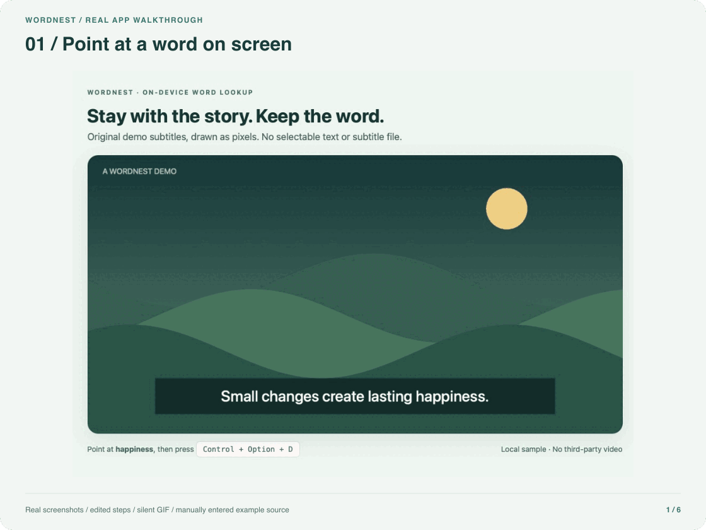
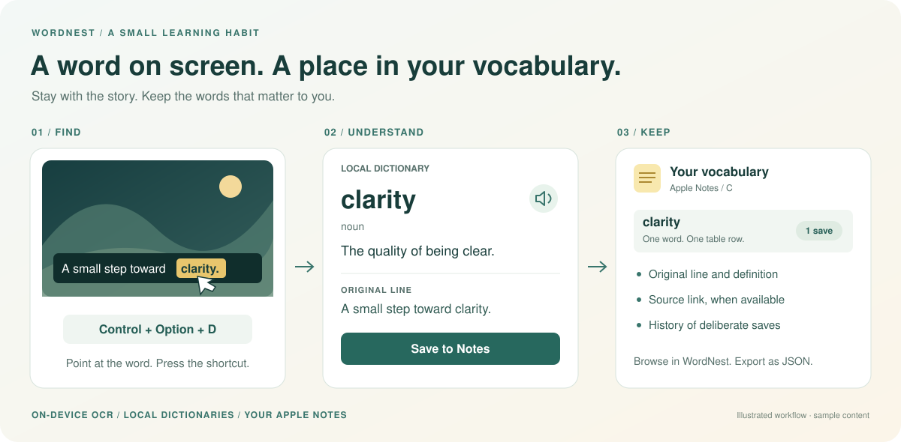
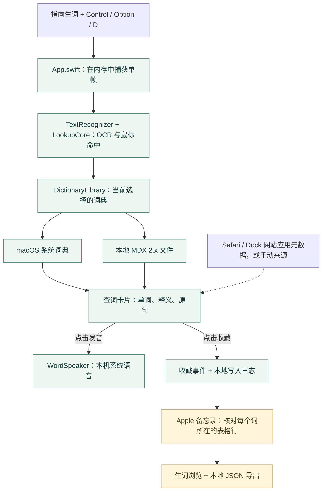

<p align="center">
  
</p>

# WordNest

**看到生词，随手查；连同原句，收进备忘录。**

[English](README.md) · 简体中文

[](https://github.com/Albort12138/WordNest/actions/workflows/ci.yml)

**Swift + AppKit 原生应用 · Apple Silicon · macOS 14+ · 代码 MIT / 形象独立许可**

[从源码体验](#从源代码构建) · [工作原理](#工作原理) · [阅读代码](#仓库地图) · [参与贡献](CONTRIBUTING.md)

WordNest 是一款免费、开源的轻量 macOS 菜单栏取词工具。看带字幕的视频，或阅读无法直接选中的文字时，将鼠标指向单词，按 **Control + Option + D**，即可查看释义、点击发音，并把单词、原句及能够取得的来源链接收藏到 Apple 备忘录。

OCR、词典查询和发音在 Mac 本机完成。WordNest 不提供账号、服务器、云端翻译或分析上报，生词保存在你自己的 Apple 备忘录中。

> **发布状态：** 当前发布候选版为 **26.1.0（build 1）**。首个公开安装包按 **未经 Apple 公证、使用 ad-hoc 临时签名** 的方式准备；自行编译无需付费开发者会员。目前尚未发布可下载的发行包。

## 看看真实使用过程



*28 秒无声步骤演示，由真实界面截图串联，并非连续录屏。字幕为自制样例，示例来源手动填写，收藏写入隔离的 `WordNest Demo` 文件夹。[拍摄说明](Assets/Documentation/README.md)。*

<details>
<summary>展开三步流程示意图</summary>




*图中为虚构内容的流程示意，并非真实界面截图。来源信息在能够取得时保存；释义取决于你选择的词典。*

</details>

| 指向取词 | 理解与发音 | 保存语境 |
| --- | --- | --- |
| 指向屏幕文字，按 **Control + Option + D**，无需先选中字幕。 | 系统词典或自行导入的 MDX 释义直接显示在卡片中，点击即可发音。 | 每个词在备忘录表格中占一行，保留原句、可取得的来源链接与主动收藏记录。 |

## 适用场景

- **看带字幕的视频：** 字幕不能选中、没有字幕文件，也可以尝试指向取词。
- **阅读无法选中的文字：** 从图片或其他应用显示的文字中识别目标词。
- **保留学习语境：** 将原行文字及能够取得的页面标题、链接一起收藏。
- **积累自己的生词本：** 在 WordNest 或备忘录中浏览生词，查看主动收藏次数，按来源筛选。

WordNest 不自动暂停视频。字幕切换、文字不清晰、鼠标未命中词框等情况可能导致识别失败；可以在卡片中修改单词后重查。

## 安装

### 下载安装包

公开安装包将发布在 [GitHub Releases](https://github.com/Albort12138/wordnest/releases)，首个下载包尚待发布。文件名含 `-unnotarized` 的版本使用临时签名，**未经 Apple Developer ID 签名或公证**，macOS 可能拦截首次启动。

1. 在正式发布的版本附件中下载 Apple Silicon `-unnotarized.dmg` 和对应的 SHA-256 校验文件，核对同名文件的校验和。
2. 打开磁盘映像，将 **WordNest.app** 拖到 **应用程序**。
3. 从应用程序启动 WordNest，完成首次使用设置。

如果系统无法验证开发者，请先阅读[中文安装说明](docs/INSTALL.zh-CN.md)或 [English installation guide](docs/INSTALL.md)，确认来源后，按 Apple 提供的流程为该应用选择 **隐私与安全性 → 仍要打开**（若系统提供）。不要关闭 Gatekeeper 或移除隔离属性；恶意软件和损坏提示需要单独排查。校验和不代表 Apple 已审查应用或确认开发者身份。

### 从源代码构建

需要 Apple Silicon Mac、macOS 14 或更新版本，以及 Apple Command Line Tools 或 Xcode。没有第三方包依赖。

```sh
git clone https://github.com/Albort12138/wordnest.git
cd wordnest
bash scripts/build.sh
open work/build/WordNest.app
```

默认构建使用独立的开发 Bundle ID 和本机开发用的临时签名，重新编译可能使原有系统授权失效。测试替代版本时请保留已经可用的授权包。公开未公证版本同样使用临时签名，更新后可能需要重新授予隐私权限。Developer ID 签名和公证保留为将来的可选路线，不是自行编译或明确标识的未公证分发的前提。

## 首次使用

设置窗口会解释并引导开启所选功能需要的权限。各项系统权限必须由你在 macOS 中亲自确认；将应用拷入“应用程序”不能自动授予权限。

首次设置以独立的 **选择你的语言** 页面开始，默认选中 **跟随系统**，旁边显示实际使用的语言；**简体中文** 和 **English** 也直接展开，无需打开菜单。切换后页面立即更新，点击“继续”再进入权限设置。界面语言与 OCR 原文识别语言独立；跟随系统会选择支持的 macOS 语言偏好，没有匹配项时使用英文。明确选择的界面语言会在权限相关的重启后保留。

以后可从菜单栏的 **设置…** 继续首次设置、修改界面语言、检查权限或修改生词本位置。授权操作集中在设置流程中；应用会在权限操作或重启前保存当前步骤。macOS 的“退出并重新打开”有时只会关闭应用，如果没有自动重新启动，请手动打开同一份 WordNest 继续设置；应用不会假定系统一定会代为启动。

| 权限 | 用途 |
| --- | --- |
| 屏幕录制 | 按下快捷键时捕获单帧，在本机识别鼠标附近的文字。屏幕取词必需。 |
| 自动化 → 备忘录 | 在你选择的位置读取、写入 WordNest 生词页面。 |
| 自动化 → Safari | 为普通 Safari 窗口读取当前页面标题和链接。 |
| 辅助功能 | 为从 Safari 添加到 Dock 的网站独立应用读取当前页面元数据。OCR 本身不需要。 |

可以使用查词而不开启自动来源获取。无法自动读取来源时，可在收藏前手动填写。保存位置请选择普通文件夹；如需智能文件夹，可另选为浏览视图。

完成设置后：

1. 鼠标指向单词，按 **Control + Option + D**。
2. 查看释义、按需点击发音，核对原句与来源。
3. 点击 **收藏到备忘录**；后续重新查到同一个词时，点击 **再次收藏** 记录新的收藏。

WordNest 常驻菜单栏。通过 **我的生词本…** 浏览和导出生词。发音仅在点击按钮时播放。

## 选择本地词典

从菜单栏或查词卡片打开 **词典…**，默认使用 **macOS 系统词典**。点击 **导入 MDX…**，选择本地 `.mdx` 文件，也可以使用你在欧路中使用的词典文件。导入后可在设置或卡片的词典选择器中切换，文本释义直接显示在 WordNest 卡片内。仅安装欧路应用并不会向 WordNest 提供释义，需要你另外提供有权使用的词典文件。

导入会校验文件，并将副本保存到 WordNest 的本地 Application Support 目录，不修改原始文件。重启后保留词典选择。移除词典只删除 WordNest 管理的副本，原文件和已收藏的生词保留。切换词典会沿用本次的单词、原句和来源链接重新查询，不会自动收藏；未命中或文件损坏时会明确提示，不会悄悄换回系统词典。

<details>
<summary>支持的 MDX 格式与资源限制</summary>

目前支持 **MDX 2.x**，UTF-8 / UTF-16LE / GBK / GB2312 / GB18030 / Big5 编码、zlib 或未压缩数据块，以及标准索引加密（标记 2）。暂不支持 MDX 1.x / 3.x、LZO 压缩和密码保护的文件。大小限制包括：单文件 1 GiB、100 万词条、解码后键数据合计 64 MiB、单个解码数据块 32 MiB、单词条 4 MiB。导入时检查容器和索引；正文数据块在查询时解压并校验。释义以纯文本呈现，不执行脚本或加载远程资源，暂不展示 MDD 图片、音频和自定义 HTML 排版；发音仍使用 macOS 语音。词典内容遵循各自的许可，与 WordNest 的 MIT 许可独立。

</details>

## 生词保存在 Apple 备忘录

- 拉丁字母词按 A–Z 分页，其他文字按文字系统分类，每个词在同一张表中占一行，收藏明细放在该行的“收藏记录”单元格中。
- 每次主动收藏的时间、原句、能够取得的来源标题与链接，追加到该单词行的收藏记录中。旧的六列表及双表笔记仍可读取，下次主动收藏时转换为单表；保留原有次数与事件编号，不因迁移重复计数。
- 后续查询中再次收藏同一个词，收藏次数加一；新原句追加，相同原句去重。同一事件的重复点击、重试、结果核对不会重复计数。
- 可以按分类浏览、搜索单词和释义、按来源筛选，或将当前已读取的生词本快照导出为 JSON，自行分析。
- 统计表示 **你主动保存的生词** 和 **收藏事件数**，不代表视频里的全部生词、观看次数或单词实际出现频率。

保存位置必须是**普通文件夹**。智能文件夹是按条件筛选的视图，不能直接接收新笔记，可以另选为浏览位置。当前不支持共享文件夹。切换目的地不会移动已有生词。

WordNest 会保护自己管理的表格：锁定笔记、重名页面、格式不符或额外内容都可能阻止更新。图片、清单及其他写作请放在单独笔记中。写入结果无法确认时，应用保留待确认事件，不会盲目再次增加收藏。

## 本地处理与隐私

WordNest 自身不发起网络请求。捕获、OCR、词典查询、发音和收藏处理使用本机 macOS 接口。画面只在内存中裁剪并用于识别，不保存、不上传，也不采集音频。

**Apple 备忘录是存储目的地。** 选择 **“我的 Mac”** 账户，可以仅在本机保存生词；选择 iCloud 或其他联网账户时，备忘录可能独立于 WordNest 同步内容。打开已保存的网站、下载词典或系统语音、下载应用本身，也涉及本地查词流程之外的网络服务。

本机设置与最小写入日志用于避免重复收藏；日志不保存单词、释义和原句正文。JSON 导出只写入你选择的位置，不会自动发送给大模型。详情见 [PRIVACY.md](PRIVACY.md)。

## 兼容性与边界

| 能力 | 当前范围 |
| --- | --- |
| 硬件与系统 | 构建目标为 Apple Silicon、macOS 14+。开发期间已在 M3、macOS 26 上测试；其他配置仍需验证。 |
| 应用界面 | 跟随系统、简体中文或英文。菜单、查词卡片、设置与生词浏览随选择切换；未知的系统诊断信息可能使用系统语言。 |
| OCR | 自动或明确选择原文语言，使用当前 macOS Vision 实际提供的语言模型。 |
| 释义 | 使用本机已启用的系统词典，或所选的本地 MDX 2.x 词典。可能返回原文解释、缺词或未命中语境的义项；能识别不等于一定能翻译成中文。 |
| 发音 | 依赖与所选或检测到的语言匹配的本机系统语音，额外语音包由 macOS 管理安装。 |
| 自动获取来源 | 普通 Safari 窗口和添加到 Dock 的 Safari 网站应用。B 站 Dock 网站应用已有本机验证；不保证所有网站、全屏和多显示器组合。 |
| 其他浏览器及播放器 | 可以尝试屏幕 OCR，来源链接可手动填写；不声称任意应用都能自动读取链接。 |
| 生词本目的地 | Apple 备忘录，尚未接入 Notion。 |

当前没有词组选取、语境 AI 解释、播放时间点识别或间隔复习。单词不做词形还原，`run` 与 `running` 分开；不同语言中相同拼写目前合并为同一行。历史记录未保存的来源无法自动重建。

切换界面语言不会翻译词典内容、已保存单词、原句、账户或文件夹名称，也不会改写已有备忘录表格结构；它们保留原内容和稳定的存储格式。

## 工作原理

查词流程在 Mac 本机完成。读取页面来源和收藏生词分别处理；仅仅查询词典不会自动增加收藏次数。



如果选择 iCloud 账户，Apple 备忘录可能独立同步。边界说明见[本地处理与隐私](#本地处理与隐私)和[架构指南](docs/code-guide.md)。

## 仓库地图

不了解 Swift 也可以先读这张地图：知道各目录负责什么，再沿着一个功能去看对应源码。

| 路径 | 内容与作用 |
| --- | --- |
| [`Sources/`](Sources/) | 应用逻辑与原生窗口 |
| [`Assets/Localization/`](Assets/Localization/) | 中英文界面翻译表 |
| [`Assets/Compatibility/`](Assets/Compatibility/) | 已有备忘录的稳定格式标识 |
| [`Assets/Fixtures/`](Assets/Fixtures/) | 演示与检查使用的固定文字 |
| [`Assets/Branding/`](Assets/Branding/) | 应用形象及独立许可 |
| [`Assets/Documentation/`](Assets/Documentation/) | 可编辑 SVG 示意图与真实界面步骤演示 |
| [`Tests/`](Tests/) | 模型、解析、语言与固定数据检查 |
| [`scripts/`](scripts/) | 构建、测试、源码导出与打包脚本 |
| [`config/product.env`](config/product.env) | 版本、Bundle ID 与构建目标的统一配置 |
| [`config/source-files.txt`](config/source-files.txt) | 公开源码导出的文件清单 |
| [`.github/workflows/`](.github/workflows/) | CI 与手动触发的草稿发行流程 |
| [`docs/`](docs/) | 架构、权限、验证与发布文档 |
| `work/` | Git 忽略的本地构建及私人开发资料 |

### 想改一个功能，从哪里开始

| 你想改什么 | 先看这些文件 |
| --- | --- |
| OCR 与鼠标取词 | [`LookupCore.swift`](Sources/LookupCore.swift) · [`TextRecognizer.swift`](Sources/TextRecognizer.swift) |
| 词典接口与导入 | [`DictionaryProvider.swift`](Sources/DictionaryProvider.swift) · [`MDXReader.swift`](Sources/MDXReader.swift) |
| 释义卡片与发音 | [`LookupCardBody.swift`](Sources/LookupCardBody.swift) · [`WordSpeaker.swift`](Sources/WordSpeaker.swift) |
| 页面链接与视频来源归类 | [`SourceCapture.swift`](Sources/SourceCapture.swift) · [`CollectionSource.swift`](Sources/CollectionSource.swift) |
| 备忘录表格、历史与收藏次数 | [`AlphabetBook.swift`](Sources/AlphabetBook.swift) · [`AlphabetNotes.swift`](Sources/AlphabetNotes.swift) |
| 首次设置与界面语言 | [`SetupWindow.swift`](Sources/SetupWindow.swift) · [`InterfaceLanguage.swift`](Sources/InterfaceLanguage.swift) |

[`App.swift`](Sources/App.swift) 协调快捷键和窗口，`captureAtPointer` 与 `lookupAndShow` 是两个定位入口。初学者可以先看 [`LookupCore.swift`](Sources/LookupCore.swift) 中的数据类型和几何规则，再读[完整模块地图及收藏约束](docs/code-guide.md)。

### 适合参与的方向

可复现的 OCR 边界案例、有权分享的 MDX 兼容性样例、备忘录读写保护、界面翻译和 macOS 兼容性报告，都适合作为参与起点。较大改动前请先看[已有问题](https://github.com/Albort12138/WordNest/issues)和[贡献指南](CONTRIBUTING.md)，分享前移除字幕、链接及生词本中的私人内容。

## 开发

版本采用 `年份.功能.修复`，当前候选版保持 **26.1.0（build 1）**，详见[版本规则](docs/RELEASING.md#version-policy)。

使用 Swift 和 AppKit，结合 ScreenCaptureKit、Vision、Dictionary Services、AVFoundation、Natural Language 与 Apple Events。界面使用英文键与独立的中英文翻译表，多语言样例和旧版备忘录标识分别保存在数据资源中。

```sh
# 核心检查；可选检查需要访问对应系统服务。
bash scripts/test.sh --system-dictionary --speech

# 固定数据 AppKit 检查，不捕获屏幕、不写备忘录。
work/build/WordNest.app/Contents/MacOS/SubtitleLookup --ui-self-test
```

预览与发行构建使用 `io.github.albort12138.wordnest` 作为 Bundle ID；默认开发构建使用 `io.github.albort12138.wordnest.development`，以区分 Launch Services 与权限身份。尚无当前选择时，可从早期原型导入经过校验的生词本与 OCR 语言偏好；不导入权限或设置完成状态。可执行文件仍叫 `SubtitleLookup`，共享的本机写入日志保留早期支持目录名称，以维持防重记录。开发产物放在 Git 忽略的 `work/` 中。真实备忘录集成测试与上述检查分开，可能写入笔记；不要把任意测试启动参数用于日常生词本。

准备经过检查的源码压缩包，不包含 Git 历史和本机构建数据：

```sh
bash scripts/export-source.sh
```

脚本将带版本号的源码包、清单和校验和写入 `work/source-distribution/`，已有导出文件时拒绝覆盖。生成本地压缩包不等于发布仓库或 GitHub Release。

更多资料：[代码指南](docs/code-guide.md)、[开发验证记录](docs/development-status.md)、[产品化评审](docs/productization-review.md)、[权限恢复指南](docs/permission-recovery.md)。

## 开源许可

WordNest 的**软件代码和文档**采用 [MIT License](LICENSE)，免费开源。你可以使用、修改和分发代码，包括商业用途；按许可证要求保留版权及许可声明即可，代码无需另行申请商业授权或支付授权费用。

**猫头鹰形象不属于 MIT 授权范围**，采用单独的[形象许可](Assets/Branding/LICENSE)，由 Albort 保留相关权利。允许下载、fork 仓库和自行编译、使用 WordNest。将该形象用于其他产品、进行形象二次创作，或随修改版应用分发，需要先通过 **albort.yao.xue@gmail.com** 取得书面许可；否则请替换为自己有权使用的素材。此前已有效授予的许可不因这次调整而撤销，详见[素材说明](Assets/Branding/README.md)。

第三方格式参考与 RIPEMD-128 的 MIT 署名见 [THIRD-PARTY-NOTICES.md](THIRD-PARTY-NOTICES.md)。软件按现状提供，不附带担保。欢迎通过 [CONTRIBUTING.md](CONTRIBUTING.md) 了解如何参与改进。

项目：[Albort12138/wordnest](https://github.com/Albort12138/wordnest)。欢迎通过 [GitHub Issues](https://github.com/Albort12138/wordnest/issues) 提交可复现的问题与兼容性报告；提交前请检查字幕、截图和来源链接中的私人内容。
